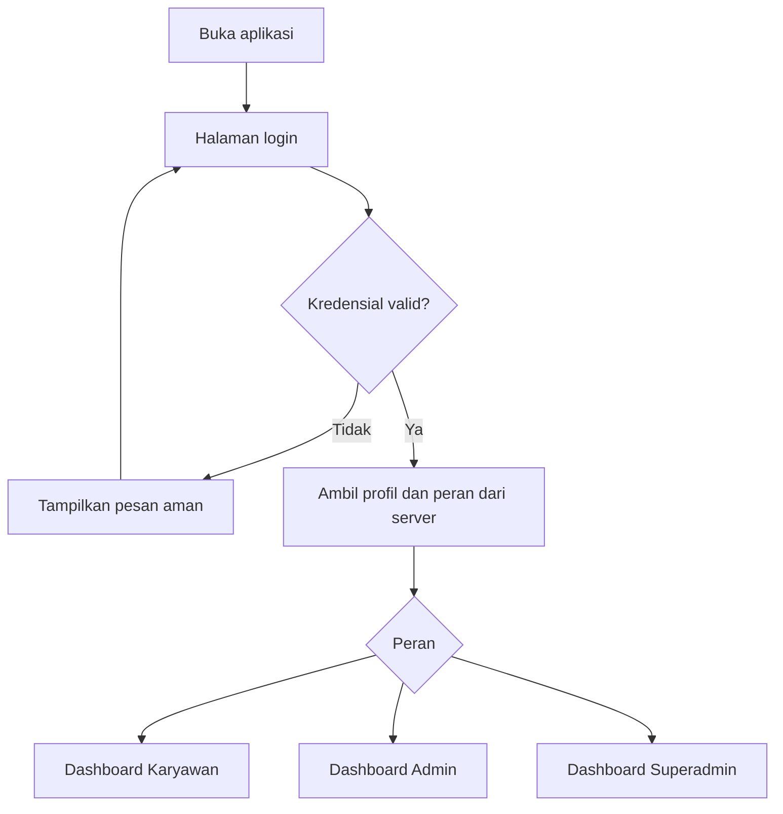
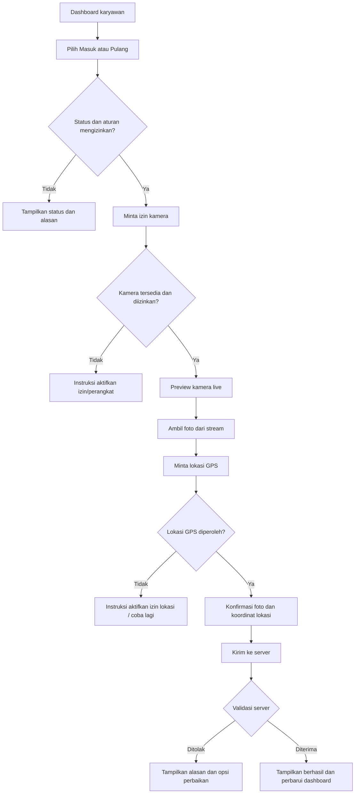

# User Flow — Absensi CV Mandala Mahardika
**Status:** Revisi SOT v0.2 — direvisi berdasarkan arahan pemilik proyek (menunggu konfirmasi)

## 1. Login dan pengarahan peran

## 2. Absen masuk/pulang

## 3. Riwayat dan laporan
- Karyawan: Dashboard → Riwayat → pilih rentang tanggal/status → detail transaksi (waktu, foto, koordinat lokasi).
- Admin: Dashboard Admin → Laporan → filter periode/karyawan/status → pratinjau → ekspor PDF atau CSV.
- Admin: Manajemen Karyawan → tambah/edit/nonaktifkan → validasi → simpan → catat audit log.
- Superadmin: Pengaturan → ubah profil kantor atau konfigurasi jadwal kerja tetap → konfirmasi → server menyimpan perubahan dan audit log.

## 4. Cabang kegagalan wajib
- Login gagal atau sesi kedaluwarsa.
- Izin kamera ditolak, kamera tidak tersedia, atau browser bukan secure context.
- Lokasi ditolak, GPS nonaktif, atau timeout pengambilan koordinat.
- Jaringan terputus atau server gagal; jangan menampilkan sukses palsu.
- Pengiriman ganda atau transaksi masuk/pulang sudah tercatat untuk hari yang sama.
- Ekspor gagal atau filter tidak menghasilkan data.

## 5. Prinsip alur
- Pengguna mengetahui tahap yang sedang berjalan.
- Foto tidak diunggah sebelum konfirmasi pengguna.
- Waktu transaksi resmi ditentukan server.
- Transaksi yang gagal tidak boleh ditampilkan sebagai absensi sukses.
